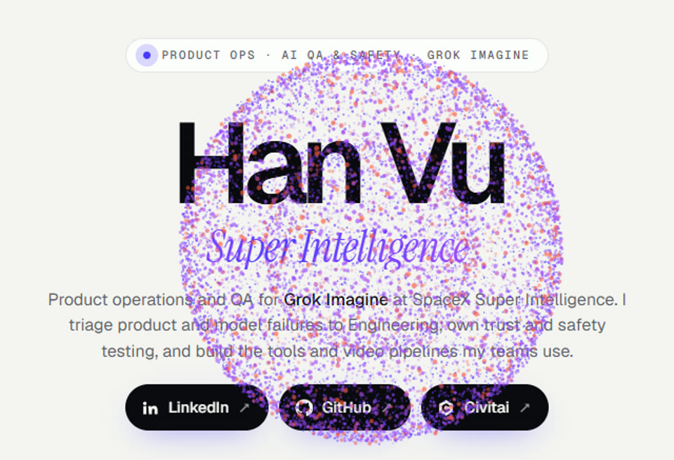

A collection of video workflows I made to help process film.

| Repo | Preview | Link |
|---|---|---|
| Han Vu Portfolio |  | [hanvu.si](https://hanvu.si) Product operations, AI QA, and the film tools below. |
| Civitai |  | [civitai.com/user/HooChoo](https://civitai.com/user/HooChoo) 137 followers · 1.8k likes · 26.4k downloads · 1.8k generations |
| Cel-shaded engine |  | [vucodehan/cel-shaded-engine](https://github.com/vucodehan/cel-shaded-engine) |
| SyncNet scorer |  | [vucodehan/syncnet-lipsync-scorer](https://github.com/vucodehan/syncnet-lipsync-scorer) |
| Resolve shot notes |  | [vucodehan/resolve-shot-notes](https://github.com/vucodehan/resolve-shot-notes) |
| Depth map converter |  | [vucodehan/depth-map-converter](https://github.com/vucodehan/depth-map-converter) |
| 2024 archive | | [vucodehan/hanvu-python-automation-2024](https://github.com/vucodehan/hanvu-python-automation-2024) |
